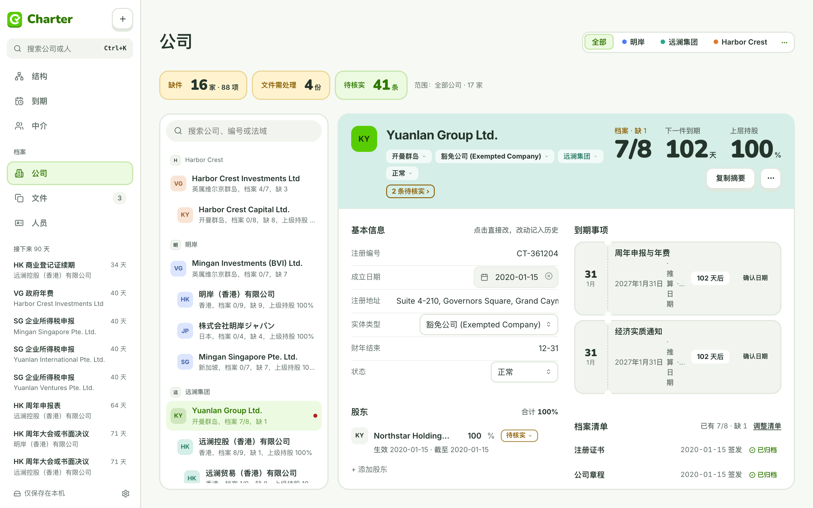
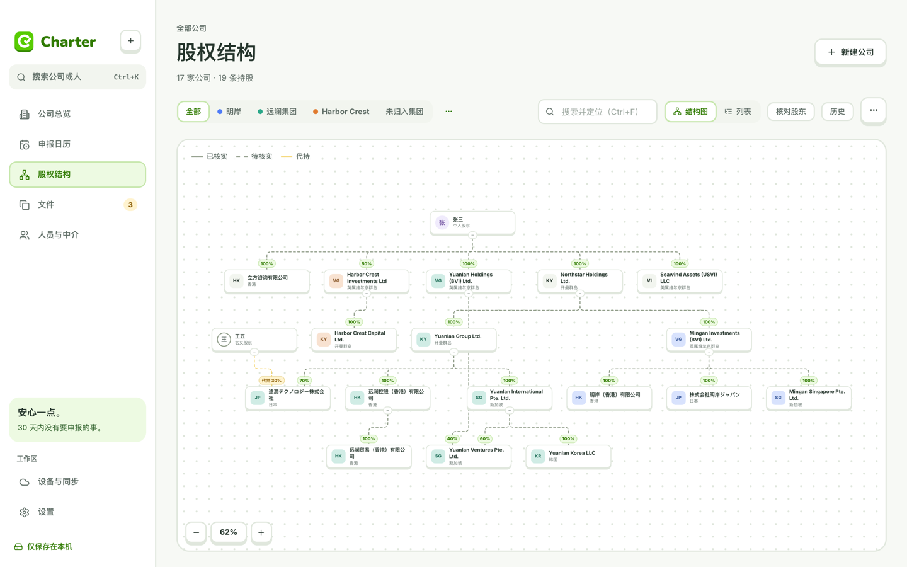
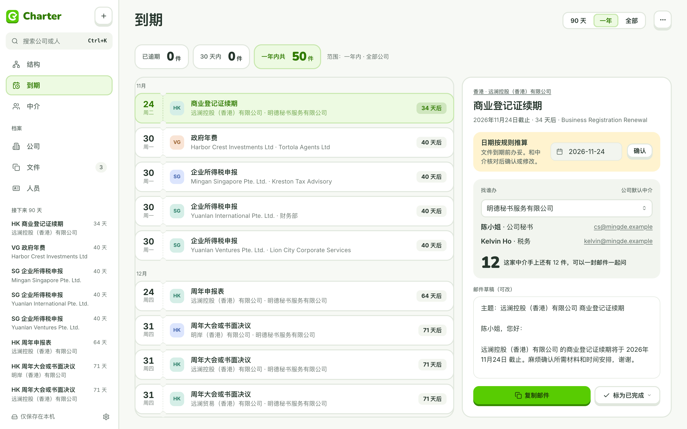
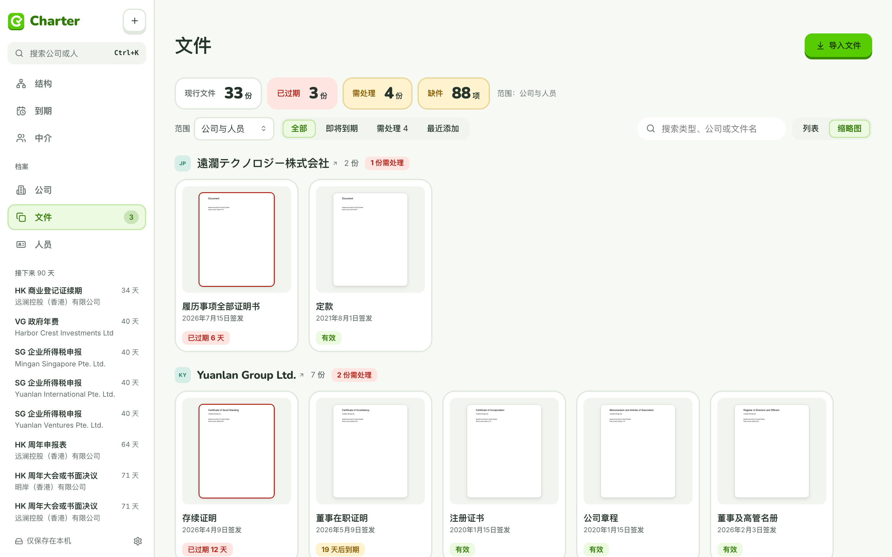
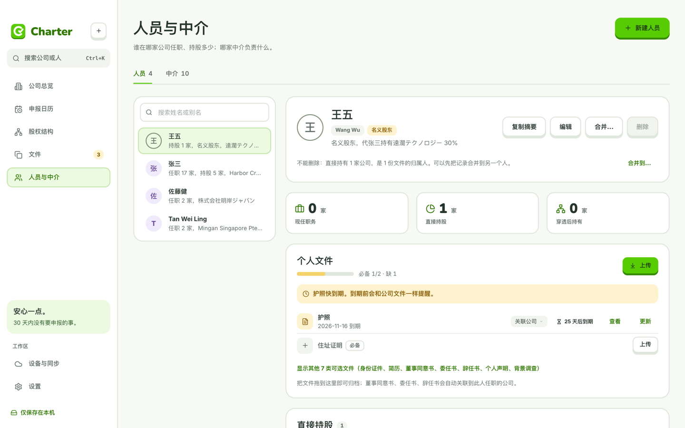

# Charter

把集团公司、股权关系、申报事项和文件放在同一个工作区。

Charter 是面向海外子公司管理的 Mac / Windows 桌面应用。你可以查看一家公司背后的股东与任职人员，追踪下一次申报，整理材料，并按用途导出带水印的文件包。

**当前版本：5.5.5** · [下载应用](#下载与安装) · [产品网站与交互演示](https://evonotevil.github.io/Charter/) · [更新记录](https://github.com/evonotevil/Charter/releases)



## 下载与安装

| 系统 | 安装包 | 其他方式 |
| --- | --- | --- |
| macOS 12+ · Apple 芯片（M1 及以后） | [下载 DMG](https://github.com/evonotevil/Charter/releases/download/v5.5.5/Charter-5.5.5-Mac-arm64.dmg) | [ZIP](https://github.com/evonotevil/Charter/releases/download/v5.5.5/Charter-5.5.5-Mac-arm64.zip) |
| macOS 12+ · Intel | [下载 DMG](https://github.com/evonotevil/Charter/releases/download/v5.5.5/Charter-5.5.5-Mac-x64.dmg) | [ZIP](https://github.com/evonotevil/Charter/releases/download/v5.5.5/Charter-5.5.5-Mac-x64.zip) |
| Windows 10 / 11 · x64 | [下载安装版 EXE](https://github.com/evonotevil/Charter/releases/download/v5.5.5/Charter-5.5.5-Windows-Setup.exe) | [免安装 ZIP](https://github.com/evonotevil/Charter/releases/download/v5.5.5/Charter-5.5.5-Windows-x64.zip) |

Mac 打开 DMG 后，将 Charter 拖入“应用程序”；Windows 运行安装程序，或解压 ZIP 后运行 `Charter.exe`。升级前先退出正在运行的 Charter。

安装包尚未使用 Apple Developer ID 或 Windows 商业代码签名证书，首次打开可能出现系统提示。Mac 可在访达中右键选择“打开”，或在“系统设置 → 隐私与安全性”中允许打开；Windows SmartScreen 可选择“更多信息 → 仍要运行”。

[完整发布说明](https://github.com/evonotevil/Charter/releases/latest) · [SHA-256 校验值](https://github.com/evonotevil/Charter/releases/download/v5.5.5/SHA256SUMS.txt)

## 能做什么

| 工作 | Charter 提供的能力 |
| --- | --- |
| 管理集团公司 | 按集团与法域整理公司，集中查看基本资料、股东、董事、高管与关联中介。 |
| 看清股权关系 | 用结构图和列表查看直接持股、穿透关系、代持与历史结构，核对缺失或待补的信息。 |
| 跟进申报与到期 | 在申报日历查看待办、记录完成情况；支持提醒、日历订阅及系统日历同步。 |
| 整理公司与个人材料 | 在“已有材料 / 完整性审阅”之间切换，设置我负责、中介保管、待确认、不在我的范围或不适用。只有“我负责”的缺项计入完整度。 |
| 保留核实依据 | 将文件关联到公司、人员、任职或持股；记录证据类型、页码和核实状态，追踪旧版与新版。 |
| 准备对外文件包 | 按用途选文件、预览水印、指定接收方和保存位置；支持清除文件信息、可选压平、发送记录及再次导出。处理导出副本，保留原件。 |
| 备份与升级 | 导出和恢复完整备份；在“关于与更新”中检查新版本、查看更新内容并前往下载。 |

系统日历同步在 Mac 上使用 Apple 日历，Windows 上需要桌面版 Outlook；也可使用 `.ics` 订阅文件。

## 界面预览

以下截图均使用虚构示例数据，具体界面以当前版本为准。点击展开查看各个工作区。

<details>
<summary>股权结构：从集团看到公司和最终持有人</summary>



</details>

<details>
<summary>申报日历：查看待办事项与到期安排</summary>



</details>

<details>
<summary>文件：集中整理档案和版本</summary>



</details>

<details>
<summary>人员与中介：关联人员、任职和服务机构</summary>



</details>

## 快速上手

1. **安装并选择数据文件夹。** 在“设备与同步”中确认数据位置。多台电脑共用档案时，可选择两端都能访问的 iCloud 云盘或 OneDrive 文件夹。
2. **先熟悉示例，再建立正式档案。** 可以先访问[网页交互演示](https://evonotevil.github.io/Charter/)。桌面版也可在设置中“载入示例数据”，请使用独立空文件夹：载入示例会替换该文件夹的当前档案。
3. **录入公司与关系。** 新建公司，补充法域和集团，关联股东、董事、高管与中介，再到股权结构核对关系。
4. **归档文件并设置材料范围。** 添加公司或个人文件，确认归属、日期与有效期；在“完整性审阅”中明确哪些材料由自己负责。
5. **跟进事项并导出材料。** 在申报日历完成待办；需要对外提供材料时，从公司页“准备文件包”进入选文件、水印和导出流程。

开始录入正式数据后，可在设置中导出完整备份。更换电脑或进行批量调整前，先保留一份备份。

## 数据放在哪里

档案保存在你选择的数据文件夹中：公司、人员及关系等记录使用 JSON，归档文件、材料包和快照存放在同一文件夹的对应目录。Charter 不要求注册账号；跨设备同步由你选择的云盘服务承担。

检查更新只读取公开版本信息，不上传档案数据。导出的 ZIP 材料包和完整备份用途不同：材料包用于对外发送，完整备份用于恢复工作区。

## 开发与源码

Charter 5 使用 **Electron + React + TypeScript**。本地开发需要 Node.js 22；进入项目后运行：

```bash
cd desktop
npm ci
npm test
npm run dev
```

在浏览器开发地址后加 `?sample` 可载入内存示例数据；运行 `npm run electron` 可打开桌面应用，读写实际数据文件夹。生产构建使用 `npm run build`。

| 目录 | 内容 |
| --- | --- |
| `desktop/src/` | 产品界面、领域逻辑与测试 |
| `desktop/electron/` | 桌面窗口、文件访问、日历等系统能力 |
| `desktop/web-demo/` | 产品网站和网页交互演示 |
| `desktop/src-tauri/` | 历史 Tauri 实现，保留作兼容参考，当前发布使用 Electron |
| `规范/` | 产品与设计规范；视觉和组件参见 [Figma · Charter](https://www.figma.com/design/wZfK0kIMBZWCxBYAtlxxa5/Charter) |
| `.github/workflows/` | Windows / macOS 原生构建、安装包验证和网站部署 |

[开发与打包说明](desktop/README.md) · [最新发布说明](https://github.com/evonotevil/Charter/releases/latest) · [全部历史版本](https://github.com/evonotevil/Charter/releases)
